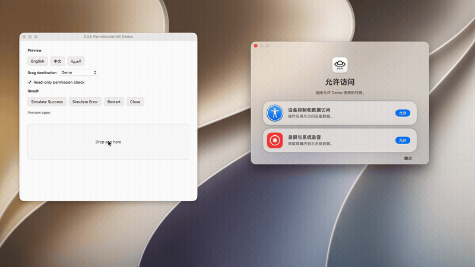

# CUA Permission Kit

[English](README.md) | **简体中文**


从 Incodex 提取的 macOS 授权引导 Swift 包。
提供设备控制与录屏授权卡，引导用户进入系统设置，展示宿主传入的权限状态。
独立社区项目，不隶属于 OpenAI，也未获得其背书。

[](Assets/Demo.mp4)

[查看 MP4](Assets/Demo.mp4) | 11.2s | 1080p

## 功能

- 两张卡：设备控制和数据访问、录屏与系统录音。
- 旧系统按版本显示辅助功能、屏幕录制。
- 默认保留单卡接入；通过 `permissions` 启用双卡。
- 保留原始卡片 token、拖拽行和弹簧动画。
- 录屏图标从系统读取；缺失时使用 SF Symbol。
- Demo 控制区独立使用 Radix 色阶与集中式 token。

## 快速开始

准备好 Xcode 命令行工具后，运行：

```sh
git clone https://github.com/daftAI2026/cua-permission-kit.git
cd cua-permission-kit
./script/build_and_run.sh
```

Demo 默认使用模拟模式。选择 **System Settings** 后才进入真实设置流程。
通过 Swift Package Manager 接入，部署目标为 macOS 12+，无外部依赖。
部署目标不代表已在所有 macOS 版本上完成运行验收。
完整接入代码与 API 见 [英文说明](README.md#integration)。

验证命令：

```sh
swift test
CUA_RUN_WINDOW_TESTS=1 swift test # 需要交互式 macOS 会话
swift build -c release
```

## 安全

库只展示状态，由宿主检查真实权限。点击或拖入应用不代表已授权。
库不重置 TCC，不提权。Demo 由本地构建，未经 Apple 公证。
旧版 macOS 和多屏定位尚未验证，详见[验收记录](EXTRACTION_AUDIT.md)。

## 什么时候显示授权卡

**建议在首次启动主应用前完成授权**，前提是安装器或启动器提供该流程。
内嵌授权卡应先显示授权界面，由宿主确认权限后，再启动录屏与自动化。

授权对象是**完成签名和安装的最终应用**，不是安装器或辅助进程。
辅助进程的权限不代表主应用权限。重新签名或保留同标识多份应用会使授权失效。

提前授权能减少额外重启，但不能保证免重启。
录屏等权限仍以 macOS 的“退出并重新打开”要求为准。

## Demo

- **Demo**：将应用拖入接收区，模拟当前卡完成，不修改系统权限。
- **System Settings**：进入对应设置页，只读探针检查真实权限；模拟按钮不代表授权成功。
- **Restart**：重置演示，不重置系统权限。

每张卡独立回飞，两张完成后关闭向导。录屏探针不单独证明仅音频权限。
`DemoSession.applicationName` 定义显示名，默认值为 `"Demo"`。

## 打开可信但未经公证的 Demo

本项目不提供使用 Developer ID 签名并经 Apple 公证的 Demo。
本机存在的 Apple Development 证书仅用于开发签名，不代表发行公证。
从源码构建不要求加入 Apple 开发者计划。明确使用临时签名：

```sh
CUA_DEMO_SIGN_IDENTITY=- ./script/build_and_run.sh
```

仅当 macOS 阻止打开**已核实来源并信任的下载副本**时，
下面的步骤才用于移除隔离属性，并仅对该 Demo 重新进行临时签名。
这不是“解除签名”，也不会授予设备控制或录屏权限。
能正常打开的应用、不可信下载，以及需要保留原 Developer ID 签名的应用，不要执行。

先退出 Demo。将 `APP` 指向要运行的准确副本；以下是构建脚本的输出路径：

```sh
APP="$HOME/Library/Caches/org.cuapermissionkit.demo/CUAPermissionDemo.app"
xattr -dr com.apple.quarantine "$APP"
codesign --force --sign - "$APP"
codesign --verify --strict "$APP"
open "$APP"
```

如需执行，请放在授权之前：重新签名会改变应用身份，可能需要重新授权。
不需要 `sudo`、全局关闭 Gatekeeper、移除代码签名或重置 TCC。
若系统显示旧 Demo 条目已开启，探针却仍未通过，先确认运行路径；
只移除并重新添加该 Demo 的旧条目，不重置其他应用的权限。

## 贡献

阅读 [AGENTS.md](AGENTS.md)，了解项目边界、开发命令与验收要求。
行为变更应附带回归测试。提交问题时，请提供 macOS 版本、构建提交和 Demo 目标。
不要上传凭据或包含私人内容的截图。

## 许可证

从 Incodex 提取，采用 MIT 许可证。见 [LICENSE](LICENSE)、
[第三方声明](THIRD_PARTY_NOTICES.md)与[来源记录](EXTRACTION_AUDIT.md)。
