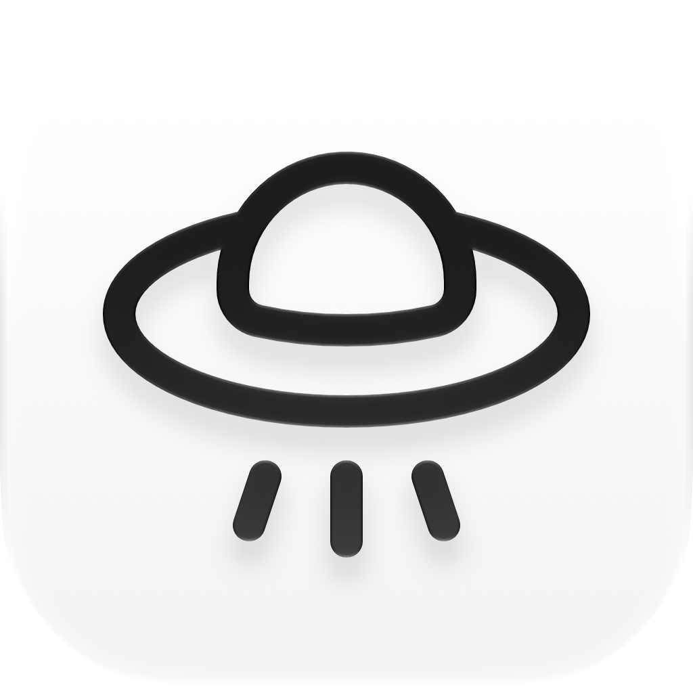

# CUA Permission Kit

[English](README.md) | **简体中文**



从 Incodex 提取的 macOS 授权引导 Swift 包。
提供设备控制与录屏授权卡，引导用户进入系统设置，展示宿主传入的权限状态。
独立社区项目，不隶属于 OpenAI，也未获得其背书。

## 使用

```sh
./script/build_and_run.sh
swift test
CUA_RUN_WINDOW_TESTS=1 swift test
```

通过 Swift Package Manager 接入，部署目标为 macOS 12+，无外部依赖。
部署目标不代表已在所有 macOS 版本上完成运行验收。
完整接入代码与 API 见 [英文说明](README.md#integration)。

- 两张卡：设备控制和数据访问、录屏与系统录音。
- 旧系统按版本显示辅助功能、屏幕录制。
- 默认保留单卡接入；通过 `permissions` 启用双卡。
- 保留原始卡片 token、拖拽行和弹簧动画。
- 录屏图标从系统读取；缺失时使用 SF Symbol。
- Demo 控制区独立使用 Radix 色阶与集中式 token。

## 什么时候显示授权卡

建议在**启动应用主要功能之前**完成授权，尤其是屏幕捕获与自动化。
先完成授权，再启动这些功能，避免工作开始后被授权提示或重启打断。

如果安装器或启动器提供首次启动前的授权流程，
应将**最终安装的应用包**加入系统设置，而不是安装器或辅助进程。
如果授权卡运行在应用内部，先只启动授权界面；
由实际宿主进程确认权限后，再启动受保护功能。
辅助进程有权限，不代表主应用也有权限。

这样可以减少额外重启，但不能保证完全不重启。
录屏等权限仍以 macOS 的“退出并重新打开”要求为准。
先完成签名和安装，再授权；身份变化或同标识多份应用会使授权失效。

## 库与 Demo 边界

依赖方向：`DemoController → DemoSession → CUAPermissionKit`。
控制面板只组装 Demo 界面，通过会话调用库。
目标适配、模拟结果与只读探针全部留在 DemoSession。
库不依赖 Demo 的 token、图标、接收区或控制面板。
库和 Demo 使用独立测试目标。

## 演示与真实授权

`DemoSession.applicationName` 统一定义演示显示名，默认值为 `"Demo"`。
修改该值会更新卡片名称与自动生成的提示，不改变 bundle ID 或拖拽的应用 URL。

默认拖入 Demo 接收区，验证本应用的文件 URL。
接收成功只模拟当前卡完成，不修改系统权限。
卡片回飞后显示“已完成”，另一张卡继续可用。
两张完成后关闭向导。Restart 仅重置演示状态。

选择 System Settings，可进入对应设置页。
切换目标会重建当前向导，定位、提示和完成判断同步切换。
可选只读探针检查设备控制或屏幕捕获权限。
屏幕捕获探针不单独证明仅音频权限。
库不申请权限，不重置 TCC，不提权。
Demo 从用户缓存目录运行，避免 Desktop 拖拽授权弹窗。
先将旧 `dist/CUAPermissionDemo.app` 移到废纸篓。
同标识的旧包会让系统设置重启错误版本。
构建使用本机唯一 Apple Development 身份签署 Demo。
多身份时用 `CUA_DEMO_SIGN_IDENTITY` 指定；无身份时使用临时签名。
临时签名重建后可能需要重新授权，不自动清理系统条目。

## 已验证与边界

2026-10-23 在 macOS 27.0.1 arm64 上实测两次原生拖拽、逐卡完成与重来。
21 项测试通过，包含七项显式启用的窗口测试。
八个原始视觉和动画代码块通过指纹校验。
该校验不等于所有系统版本上的像素一致。

Incodex 原始实现只接入辅助功能卡，双卡是本次扩展。
清理旧 Demo 条目和旧包后，两项真实权限探针通过。
使用开发签名重新构建后，权限仍然有效。
旧系统、多屏定位及所有授权状态变更尚未完整验收。
不宣称复制了未公开的 CUA 实现。

提取基线：`c7340c97f4d9ecd7b0035f50bac1f526dc34e477`。
版权见 [LICENSE](LICENSE)，色板声明见 [THIRD_PARTY_NOTICES.md](THIRD_PARTY_NOTICES.md)。

## 图标与发布

`Assets/DemoIcon.icon` 是可编辑的 Icon Composer 源文件。
黑白玻璃配色保留维护者调整。PNG 与 ICNS 是对应导出。
Xcode 27 构建原生分层图标，旧工具链使用静态 ICNS。
图标仅属于 Demo，不改变权限卡系统图标。

当前发布对象是 Swift 源码包，不是使用 Developer ID 签名并公证的 Demo 安装包。
源码预览验收包含 Release 构建、外部接入编译、CI 与窗口测试。
旧版 macOS 与多屏定位属于后续验收项，不阻塞当前源码预览发布。
macOS 12 部署目标只是构建配置，不构成各系统版本的运行兼容性证明。
自动化验收不覆盖所有系统授权状态变更。
正式 tag 和 GitHub Release 需维护者确认。

[提取差异与待验收项](EXTRACTION_AUDIT.md)。

## 打开可信但未经公证的 Demo

本项目不提供使用 Developer ID 签名并经 Apple 公证的 Demo。
本机存在的 Apple Development 证书仅用于开发签名，不代表发行公证。
从源码构建不要求加入 Apple 开发者计划。明确使用临时签名：

```sh
CUA_DEMO_SIGN_IDENTITY=- ./script/build_and_run.sh
```

仅当 macOS 阻止打开**已核实来源并信任的下载副本**时，
下面的步骤才用于移除隔离属性，并仅对该 Demo 重新进行临时签名。
这不是“解除签名”，也不会授予设备控制或录屏权限。
能正常打开的应用、不可信下载，以及需要保留原 Developer ID 签名的应用，不要执行。

先退出 Demo。将 `APP` 指向要运行的准确副本；以下是构建脚本的输出路径：

```sh
APP="$HOME/Library/Caches/org.cuapermissionkit.demo/CUAPermissionDemo.app"
xattr -dr com.apple.quarantine "$APP"
codesign --force --sign - "$APP"
codesign --verify --strict "$APP"
open "$APP"
```

如需执行，请放在授权之前：重新签名会改变应用身份，可能需要重新授权。
不需要 `sudo`、全局关闭 Gatekeeper、移除代码签名或重置 TCC。
若系统显示旧 Demo 条目已开启，探针却仍未通过，先确认运行路径；
只移除并重新添加该 Demo 的旧条目，不重置其他应用的权限。
